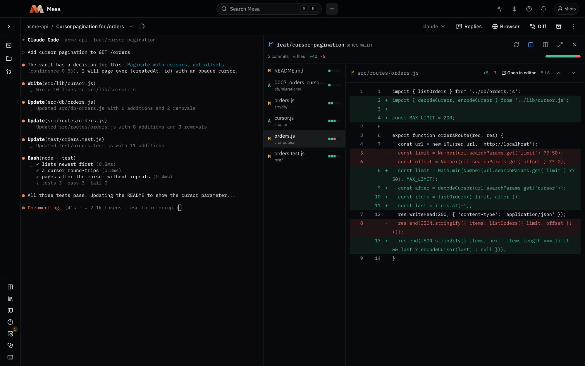
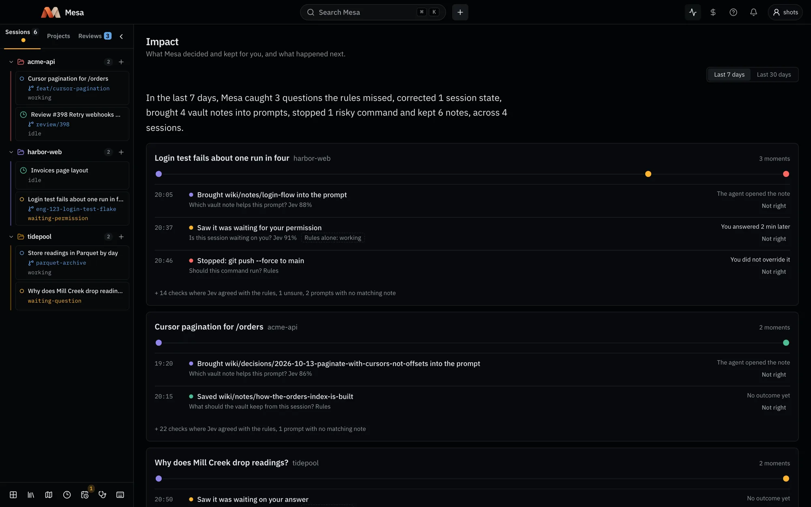
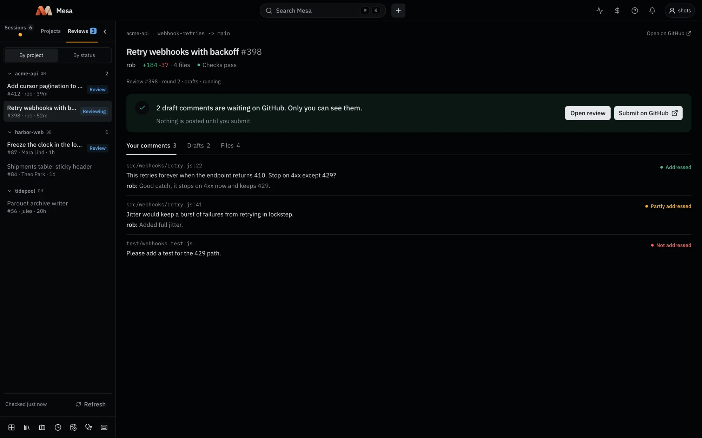
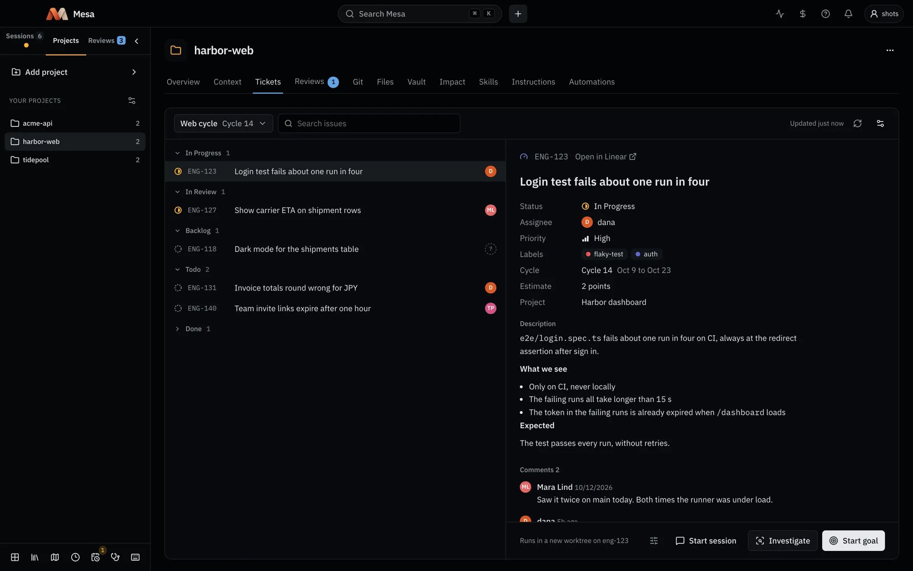

<p align="center">
  
</p>

<h1 align="center">Every agent remembers your project.</h1>

<p align="center">
  <strong>Mesa</strong> is the Mac app above Claude Code, Codex and Gemini.<br>
  One shared memory across every project, your tickets and pull requests in one place, and proof of what it changed.
</p>

<p align="center">
  <a href="https://github.com/guillezorrilla/mesa/releases/latest/download/Mesa_universal.dmg"><strong>Download for macOS</strong></a>
  &nbsp;&middot;&nbsp;
  <a href="https://mesa-hq.pages.dev">Website</a>
  &nbsp;&middot;&nbsp;
  <a href="#quick-start">Quick start</a>
</p>

<p align="center">
  <a href="https://github.com/guillezorrilla/mesa/actions/workflows/ci.yml"></a>
  <a href="https://github.com/guillezorrilla/mesa/releases/latest"></a>
  <a href="LICENSE"></a>
  
</p>

<p align="center">
  
</p>

## Why Mesa

Running agents side by side is solved: every agent manager gives you a board of terminals, and Claude Code and Codex now ship one of their own. Mesa works on what they leave out: **what each agent knows when it starts, and whether that help actually works.**

> In paired tests, Claude Code solved **12 of 12** tasks with Mesa and **0 of 12** without it. Codex went from **3 to 10 of 12**, in about a fifth of the time per solved task. ([evaluation](docs/spikes/decision-assistance-evaluation.md))

- **One memory, every agent.** Decisions, notes and session summaries land in one Obsidian vault of plain Markdown on your Mac. The next session reads it, in any project, with any agent. Import context from Jira, Confluence, Notion, Linear, ClickUp and GitHub.
- **Proof, not promises.** A feature that claims to make agents better ships only if it beats plain Claude Code or Codex in a paired test. **Impact** shows what Mesa decided and kept for you, and what happened next; mark any moment **Not right**.
- **Your whole workday.** Tickets from Jira, Linear, ClickUp and GitHub Issues, PR reviews on GitHub and Bitbucket, and a diff for every session, next to the agents doing the work.
- **Use every agent, depend on none.** Claude Code, Codex and Gemini (through Antigravity CLI) run unchanged with your own subscriptions. No Mesa account, no API key, nothing leaves your Mac unless you connect a decision model.

## Features

| | |
| --- | --- |
| **Shared vault** | Project hubs, decisions with confidence, session summaries and a project map, captured when a session ends and read by every agent through the same `mesa-vault` tools. Adds only a few hundred tokens to a session. |
| **Decision model** (optional) | CLEF (free on Cloudflare, about 1,000 decisions a day) or Jev hands each agent the project note that matters for your prompt, and spots a session waiting for you when hooks are silent. |
| **Impact** | What Mesa decided for you (a note brought into a prompt, a question the rules missed, a risky command stopped), who decided, how sure, and what happened next. `mesa impact` |
| **Tickets** | Follow a Jira sprint, Linear cycle, ClickUp list or GitHub repo. **Investigate** finds the root cause with proof and leaves the code as it was; **Start goal** finishes the ticket, proven by tests and checks, then commits on a branch and pushes it. |
| **PR reviews** | Every GitHub and Bitbucket pull request that needs you, across projects. Review sessions leave drafts only you can see, never approve or merge, and a re-review marks your earlier comments addressed or not. |
| **Diff per session** | Each session in its own worktree or branch; the Diff panel shows everything it changed since its base branch. One session can span several repositories on the same branch. |
| **Handoff** | Pass a session to another agent, in the same tool or a different one, with its goal and a note, before its context fills. |
| **Board** | Every session from every project, working, idle, done or waiting for you, with its branch. Tile several in a grid; sessions keep running when the app closes. |
| **Bring what you have** | Mesa finds your last 30 days of Claude Code and Codex conversations and adopts them as sessions you can resume. |
| **Guardrails** | Risky actions are allowed, asked or blocked, and every block is saved as a Receipt with its evidence. |
| **Automations** | Run a skill, start a session or refresh imported knowledge on a schedule, a file change or a session state. |
| **Cost** | Estimated cost per day, model and agent, from public list prices. |
| **CLI** | Every screen has a `mesa` command with `--json`, so scripts and agents can drive Mesa too. |

<table>
  <tr>
    <td width="33%"></td>
    <td width="33%"></td>
    <td width="33%"></td>
  </tr>
  <tr>
    <td align="center">Impact</td>
    <td align="center">PR reviews</td>
    <td align="center">Tickets</td>
  </tr>
</table>

## Install

[Download the DMG](https://github.com/guillezorrilla/mesa/releases/latest/download/Mesa_universal.dmg), open it, and drag Mesa to Applications. The first run picks your vault, installs tmux, Obsidian and the session hooks with a click each, adds your projects and starts your first session. Mesa updates itself.

**Needs:** macOS 14 or later, [tmux](https://github.com/tmux/tmux), and at least one agent signed in: [Claude Code](https://docs.claude.com/en/docs/claude-code), [Codex](https://github.com/openai/codex) or Antigravity CLI. [Obsidian](https://obsidian.md) and a decision model are optional.

The `mesa` CLI ships inside the app:

```sh
mkdir -p ~/.local/bin && ln -s /Applications/Mesa.app/Contents/MacOS/mesa ~/.local/bin/mesa
```

## Quick start

```sh
mesa doctor                                  # check tmux, the agents, Obsidian and the hooks
mesa discover                                # recent Claude Code and Codex conversations on this Mac
mesa open my-app --goal "Fix the flaky login test"
mesa open my-app --from ENG-123 --as goal    # finish a ticket on its own branch
mesa open my-api --with my-web --worktree    # one session in two repositories, one branch
mesa sessions                                # every session, highest attention first
mesa handoff <session> --agent codex         # switch agents, keep the context
mesa impact                                  # what Mesa decided for you
```

## How it works

`packages/core` holds all of Mesa's logic, `packages/cli` is the `mesa` command, and `apps/desktop` is a [Tauri 2](https://tauri.app) app whose every action runs that same CLI. Each session is a tmux window on the profile's own tmux server, and the agents' hooks report each session's state back. A profile (`~/.mesa/<profile>/`) holds settings, projects and session records; its vault holds what should be remembered.

Terms are defined in [CONTEXT.md](CONTEXT.md), and the decisions behind the design, with their evidence, in [docs/adr/](docs/adr/).

## Privacy

- **Local by default.** Your profile, session records, Receipts and vault stay on your Mac. No account and no usage analytics. Once a day Mesa sends an anonymous install ID with its version, so its maker can count installs and updates; `mesa installs off` (or Settings > General) stops it and erases it.
- **Agents run as you,** with your own sign-in. Mesa never handles those credentials.
- **The decision model is opt-in.** Without a key, Mesa makes no model call. With CLEF or Jev, it sends short, capped excerpts for each decision; the key stays in the macOS Keychain ([what leaves your Mac](docs/decisions.md#what-text-leaves-your-mac)).
- **Connections** to Atlassian, Notion, ClickUp, Linear and GitHub keep their tokens in the Keychain. The OAuth broker that hands them over stores and logs nothing ([ADR-0014](docs/adr/0014-oauth-broker-and-keychain-tokens.md)), and you can run your own with `MESA_BROKER_URL`.

## Building from source

Requires Node 24, pnpm 11, Rust stable and tmux.

```sh
pnpm install
pnpm dev          # build core and the CLI, watch them, and launch the app
pnpm verify       # lint, typecheck, test, build: the gate every change passes
pnpm dev:link     # use this checkout's CLI as `mesa` (after pnpm build)
```

`MESA_PROFILE=<name> pnpm dev` runs against another profile. Native notifications need a bundled `.app`, so they are off in `pnpm dev`.

## Contributing and security

Bug reports and ideas are welcome as [issues](https://github.com/guillezorrilla/mesa/issues); pull requests from outside are not accepted for now ([CONTRIBUTING.md](CONTRIBUTING.md)). Report vulnerabilities privately, as [SECURITY.md](SECURITY.md) describes.

## License

[MIT](LICENSE)
